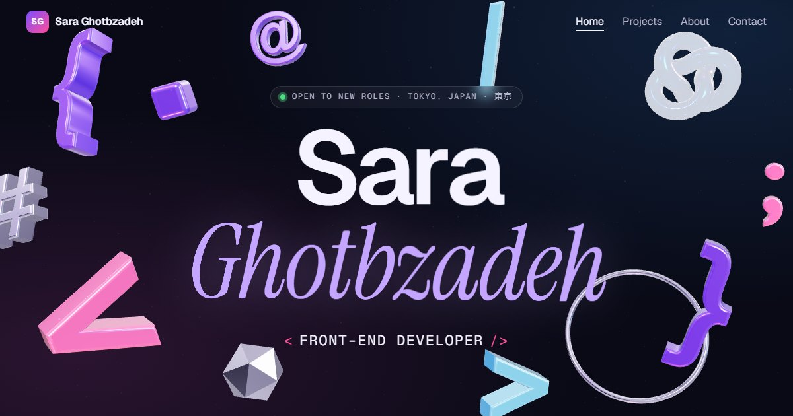

  

<h1 align="center">Sara Ghotbzadeh</h1>

<strong>Front-End Developer</strong> · Tokyo, Japan

  
  

I build interactive web applications with **Vue, Nuxt, and TypeScript**. At Qoo Studio, I helped build a reusable real-estate sales platform, working on buyer-facing search, property maps, and rule-based home configuration. I also build scroll-driven 3D experiences with Three.js and GSAP.

## Selected work

| Project | What I built | Explore |
| --- | --- | --- |
| **Home Configurator** | A guided flow that shows which home models, elevations, and options are available for a selected lot. | [Case study](https://sara-ghotbzadeh-portfolio.vercel.app/projects/home-configurator) |
| **Interactive Site Plan** | A data-driven SVG map that connects lot availability with compatible home models. | [Case study](https://sara-ghotbzadeh-portfolio.vercel.app/projects/interactive-site-plan) |
| **Miyuki Beads Designer** | A browser-based tool for designing bead patterns. | [Live app](https://sarah-gh.github.io/miyuki-beads-designer/) |
| **Developer Portfolio** | A Nuxt site with scroll-driven transitions and a live Three.js scene. | [Live site](https://sara-ghotbzadeh-portfolio.vercel.app/) |

## Technologies

Also working with Pinia, TanStack Query, SVG, Vitest, Vite, and Git.
